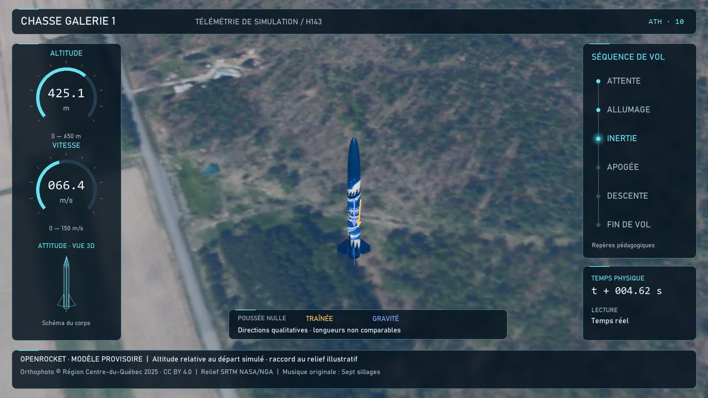

# Chasse Galerie 1 — Affichage tête haute v10

Livraison du 24 octobre 2026 : vidéo complète avec panneaux de verre dépoli, jauges radiales, vue filaire 3D, chronogramme lumineux, vecteurs didactiques et bilan à l’atterrissage. Publiée sur GitHub : commit `44514d0`, présence distante vérifiée le 24 octobre 2026.

- [Vidéo MP4 avec ATH et son](chasse-galerie-1-ath.mp4) : 1920 × 1080, 30 images/s, 1 217 images, 40,57 s.
- [Projet Blender](chasse-galerie-1-ath.blend). **Conserver le MP4 dans le même dossier** : la scène 06 le référence par chemin relatif. Le son est intégré au fichier Blender.
- [Bilan à l’atterrissage](apercu-1100.jpg), [données du bilan](donnees/bilan.json) et [paramètres ATH](donnees/ath.json).

## Interface et lecture

Les panneaux latéraux utilisent un arrière-plan flouté, un voile sombre et des contours fins. Les polices sans empattement Bahnschrift et monospace Consolas proviennent du système Windows; leurs fichiers ne sont pas redistribués. La fusée et le parachute restent au centre. Les jauges couvrent 0–650 m et 0–150 m/s.

La vue filaire est un **schéma 3D du corps** orienté selon l’attitude exportée depuis Blender, et non un plan de fabrication. Le chronogramme suit Attente, Allumage, Inertie, Apogée, Descente et Fin de vol, avec une lueur sur le repère courant. Ce sont des repères pédagogiques, pas une nomenclature officielle de certification. L’apogée est soulignée pendant une courte fenêtre visuelle autour de l’événement.

Le temps physique, le facteur de lecture et les secondes d’animation après contact sont distingués. L’altitude reste relative au départ de la simulation; elle ne représente pas la hauteur instantanée au-dessus du relief.

## Vecteurs et bilan didactique

Les flèches apparaissent pendant deux passages courts de la montée : images 76–106 et 165–230. Elles montrent des **directions qualitatives**, avec des longueurs non comparables. La gravité est verticale vers le bas, la poussée suit l’axe de la fusée et la traînée s’oppose à la vitesse relative à un vent moyen de 2 m/s vers l’ouest. Les fluctuations du vent ne sont pas reconstituées. Aucune valeur de traînée, de poids ou de bilan des forces en newtons n’est inventée. La poussée est signalée nulle dans la séquence sans moteur.

À partir du contact, le panneau gauche présente un bilan uniforme avec courbe altitude/temps physique : apogée **592,6 m**, vitesse maximale **149,2 m/s**, durée simulée **106,68 s**, dérive **163,8 m** et vitesse au contact **6,30 m/s**. Cette dernière précède l’amortissement visuel. La mise en page retenue remplace la consigne initiale tronquée après « mise en page standar »; aucune conformité à un modèle officiel n’est revendiquée.

## Intégration et reproduction

Les images proviennent du rendu 3D v8; le son AAC de la v9 est conservé **à l’identique**, sans réencodage audio. Le décor, la trajectoire et la caméra ne sont pas recalculés. Les panneaux sont composés par le script `sources/creer-ath.py`, puis le film est intégré au séquenceur Blender en scène 06. Les scènes 3D antérieures restent disponibles. **La disposition de l’ATH se modifie dans le script**, et non avec des objets texte 3D dans Blender.

Reconstruction dans la structure locale du projet :

1. Conserver la scène v9 sous `outputs/son-v9` et les données de télémétrie v8 sous `outputs/cinematographie-v8/donnees`.
2. Reprendre les 1 217 images sans titres dans `work/cinematographie-v8/frames/vol-0001.jpg` à `vol-1217.jpg`, ou les régénérer depuis la scène 03 du projet v8.
3. Exécuter `exporter-projections.py` dans Blender sur la scène v9.
4. Exécuter `creer-ath.py` avec Python, NumPy et Pillow; les polices Windows indiquées doivent être présentes ou remplacées dans le script.
5. Exécuter `encoder-verifier.py` avec FFmpeg, puis `integrer-blender.py` dans Blender sur la scène v9. Les scripts utilisent `outputs/ath-v10` et `work/ath-v10`.

Le [rapport vidéo](verification-video.json) confirme le décodage intégral sans erreur et l’identité du flux audio. Le projet a été rouvert et sa scène 06 rendue pour vérifier le lien relatif au MP4 et la présence du son intégré. Huit aperçus couvrent attente, propulsion, montée, apogée, descente, contact et repos.

## Crédits

Orthophoto **© Région Centre-du-Québec 2025**, MRNF, [CC BY 4.0](https://creativecommons.org/licenses/by/4.0/deed.fr); relief NASA/NGA, [SRTM GL1](https://doi.org/10.5067/MEaSUREs/SRTM/SRTMGL1.003), OpenTopography; origine du site © [contributeurs OpenStreetMap](https://www.openstreetmap.org/copyright), ODbL. Animation, ATH et musique originale synthétisée « Sept sillages » : projet Chasse Galerie 1, avec assistance Codex. Modèle provisoire et sons illustratifs; aucune validation du kit réel.
