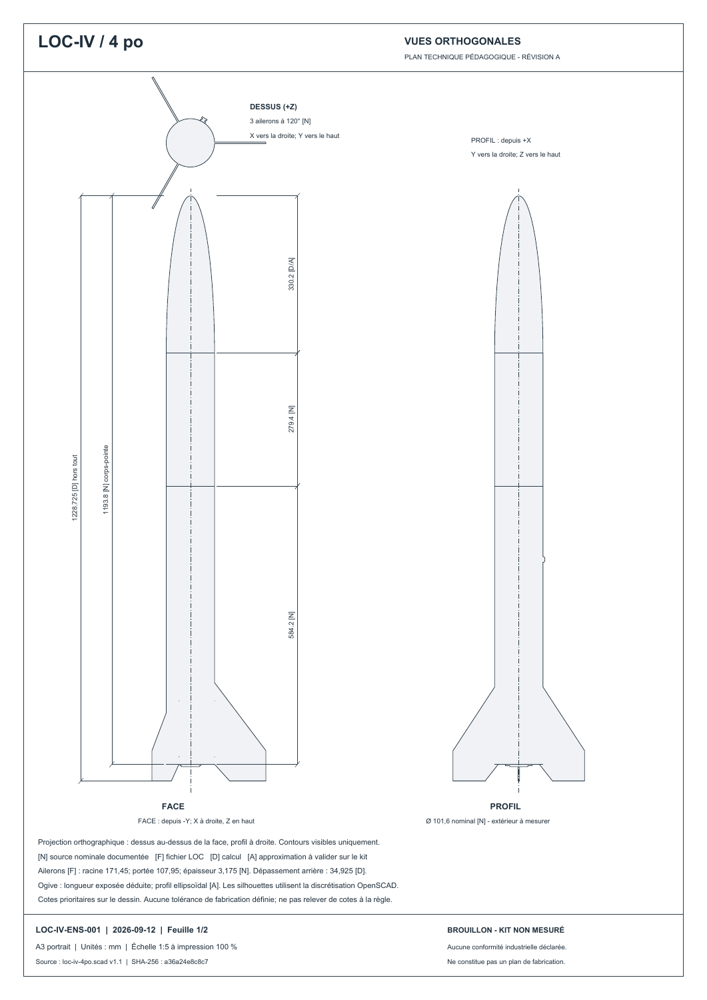

# 02 — Décorer un tube et lire un plan

**But :** comprendre un décalque comme une étiquette autour d’une bouteille, puis retrouver les vues du plan.

## A. Comprendre le tour du tube

1. Ouvre la [notice du Sillage fleurdelisé](../plans/decalques/sillage/README.md) et son PDF d’épreuve.
2. Dessine sur papier un rectangle représentant le tour du tube. Sa largeur nominale est `π × 101,6 = 319,186 mm`.
3. Ajoute les 5 mm de recouvrement : la coupe fait 324,186 mm de large.
4. Autour de la coupe, le fichier ajoute encore 3 mm de fond perdu de chaque côté : largeur du document 330,186 mm. Le fond perdu sera coupé; le recouvrement restera sous le bord voisin.
5. Imprime l’épreuve à **100 % / taille réelle**, sans « ajuster ». Si elle dépasse la feuille, utilise l’impression en affiche/mosaïque du lecteur PDF.
6. Mesure la barre de 100 mm. Si elle ne fait pas 100 mm, corrige l’impression avant tout essai.
7. Avec l’aide d’un adulte pour découper, fais un essai papier. N’envoie pas cette maquette provisoire comme fichier définitif d’impression.

**Je vérifie :** je sais montrer le tour, le recouvrement et le fond perdu. La source bitmap fait environ 61 pixels par pouce à cette taille : l’agrandir ne crée pas de détails. Le texte et le drapeau devront être préparés proprement avant fabrication finale.

## B. Voir le décor sans papier

1. Ouvre [chasse-galerie-1-sillage.ork](../plans/decalques/sillage/chasse-galerie-1-sillage.ork) dans OpenRocket.
2. Choisis la vue **3D Finished**, puis tourne le modèle.
3. Ouvre **Appearance / Apparence** d’un tube. Observe l’image et ses réglages sans les changer.
4. La rotation vaut 0, l’échelle U/V 1/1 et le décalage U 1/6 dans cette référence. L’image d’un tube est différente de l’image de l’autre tube.
5. Compare le côté du motif et le côté du raccord avec les images de la notice.

Dans OpenSCAD, le décor est une mosaïque de petits morceaux colorés. F5 la montre; le STL ne conserve pas une texture photographique. Dans Blender, les images sont posées sur la surface avec des coordonnées **UV**, comme le patron d’un emballage.

**Création artistique :** l’illustration du Sillage a été générée à partir d’un prompt archivé. Retaper ce prompt ne garantit pas les mêmes pixels. Pour reprendre exactement notre décoration, conserve l’[illustration source](../plans/decalques/sillage/illustration-source.png). Pour faire ton propre dessin, utilise-la seulement comme référence et note qu’il s’agit d’une variante.

## C. Poser une texture dans Blender

Pour refaire l’application sans reconstruire les coordonnées de la surface :

1. Dans une copie de la scène artistique ou de vol, sélectionne le tube extérieur visible. Passe dans Shading.
2. Dans son matériau, retrouve le nœud **Image Texture** relié à la couleur du matériau.
3. Utilise son bouton Open pour choisir `texture-booster.png` pour le tube bas, ou `texture-payload.png` pour le tube haut, dans le dossier du Sillage.
4. Garde les coordonnées UV existantes : elles disent où placer l’image sur ce tube. Ne choisis pas le SVG avec fonds perdus comme texture.
5. Rends le côté du motif puis le côté du raccord. Le canot appartient à la section haute, le nom à la section basse.

Pour apprendre les UV depuis zéro, dans un fichier d’exercice ajoute un cylindre. En Edit Mode, sélectionne une arête verticale, puis **Edge → Mark Seam** : c’est l’endroit où l’on « ouvre l’étiquette ». Sélectionne ses faces et utilise **UV → Unwrap**. Dans UV Editing, observe la surface à plat, ouvre une image, puis ajoute cette même image dans le matériau. Les bouchons du cylindre forment aussi des morceaux à plat : ce sont des îlots UV distincts.

Ce cylindre d’exercice explique le principe. Pour retrouver exactement le raccord à 60° et le sens de l’image des tubes du projet, conserve les UV du fichier livré ou reconstruis-les avec sa recette. Déplacer un îlot UV modifie l’image sur le tube, pas la forme du tube.

## D. Lire et refaire une planche

1. Ouvre le [plan d’ensemble, révision B](../plans/ensemble/README.md).
2. Sur la feuille 1, trouve face, profil et dessus. Sur la feuille 2, retrouve l’aileron dans la nomenclature.
3. À l’échelle 1:5, 100 mm sur la vraie pièce deviennent 20 mm sur le papier, si l’impression reste à 100 %.
4. Pour ta planche manuelle, exporte trois images OpenSCAD des mêmes vues. Place-les dans un document, écris les noms des vues et ajoute un titre, une date et « modèle provisoire ».
5. Recopie les cotes depuis le modèle, jamais en mesurant les pixels d’une image.

Cette planche d’exercice ne reproduit pas automatiquement le PDF A3. Le [générateur du plan](../plans/ensemble/README.md) produit les projections et la mise en page exactes; certaines annotations sont éditoriales et doivent être relues après une modification.

[Suite : Blender](03-blender.md) · [Sommaire](README.md)
