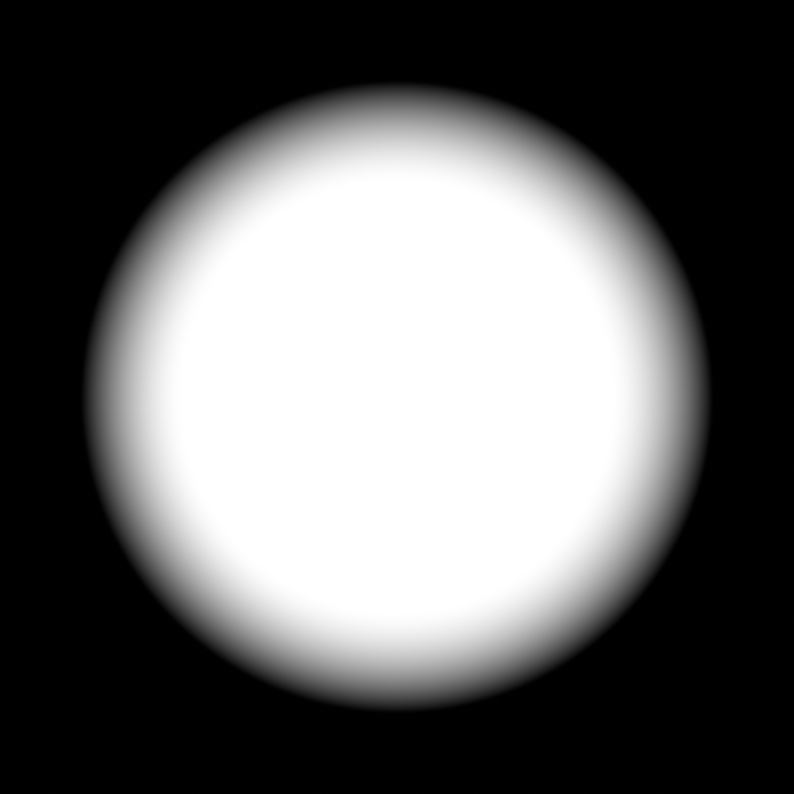

# 07 — Une carte, un relief et un sol détaillé

**But :** comprendre comment le paysage réel et les détails inventés se rejoignent.

## Trois couches, comme un gâteau

1. **Le relief SRTM** donne les grandes hauteurs : un quadrillage d’échantillons, pas les petits cailloux.
2. **L’orthophoto** donne les couleurs vues d’en haut. Elle provient ici d’un avion, pas d’un satellite.
3. **Le sol PBR et les chaumes** donnent des détails près de la caméra. PBR désigne des réglages de matière et de lumière; ce n’est pas une mesure du champ réel.

## A. Inspecter le site enregistré

1. Ouvre la [scène topographique v5](../plans/animations/topographie/README.md), puis la scène **02 — Site SRTM géoréférencé**.
2. Observe la carte et les deux routes. L’origine est l’intersection du rang Letendre et du 10e Rang : latitude 46,004782°, longitude −72,7232675°.
3. Le repère du projet est **UTM 18N, EPSG:32618**. Ces nombres nomment la règle utilisée pour transformer la Terre ronde en coordonnées de travail.
4. Dans la copie v10, compare la scène 02 et la scène 03. Le pas de tir illustratif est déplacé de 80 m à l’ouest de l’intersection.
5. Ne déplace pas seulement la rampe pour changer le site : le sol détaillé, le masque, les chaumes et les appuis doivent suivre le même changement.

**Je vérifie :** je distingue l’intersection de référence et le point de lancement provisoire. Les décimales ne prouvent pas que le terrain a été mesuré au centimètre.

## B. Comprendre l’import d’origine

BlenderGIS 2.2.14 a servi au géoréférencement. Le module n’est pas requis pour ouvrir les scènes livrées. Les sources contiennent son archive originale, les GeoJSON et le GeoTIFF recadré.

Pour préparer une reconstruction, note dans ta fiche : EPSG:32618, origine Est 676275,912 m, Nord 5097099,002 m, et 1 unité Blender = 1 m. Le raster source est géographique; les sommets ont été **reprojetés**, pas simplement étirés avec S.

Le terrain natif a 57 200 sommets. Le terrain de rendu en a davantage par interpolation : on ajoute des points entre les points existants, **pas de nouvelles mesures**. Le pipeline géographique exact est expliqué au chapitre 13. Un clic « importer une image comme plan » ne remplace pas cette opération.

## C. Lire le mélange du sol

1. Dans la scène 03, cherche `TERRAIN HYBRIDE` dans l’Outliner.
2. Ouvre **Shading**, puis affiche tous les nœuds avec **Home** dans l’éditeur.
3. Repère l’image d’orthophoto, les nœuds de terre, puis `MASQUE — fondu doux de 24 à 36 m`.
4. Lis **From Min = 24**, **From Max = 36**, interpolation **Smoothstep**.
5. Dans une copie d’essai, change temporairement 24/36 en 12/18, puis rends une vue du sol. Compare avec la référence avant de revenir à 24/36.

Le masque mesure la distance horizontale au pas de tir. À 24 m, le détail est maximal; à 30 m, le mélange est à mi-chemin; à 36 m, l’imagerie prend le relais. C’est comme effacer doucement le bord d’une peinture pour la fondre dans une autre.

## D. Construire un masque simple à la main

Dans un fichier neuf, crée un plan et un Empty au centre. Dans son matériau, ajoute Texture Coordinate, choisis l’Empty dans le champ Object, puis branche **Object → Vector Math (Length) → Map Range → facteur de Mix**. Comme ton plan est plat à Z=0, Length donne ici la distance au centre. Dans Map Range, choisis Smoothstep, les bornes 24/36 et Clamp. Mélange deux couleurs très différentes pour bien voir la transition.

Le terrain réel utilise la distance **XY**, sans inclure la hauteur Z. Pour l’adapter au relief, sépare XYZ et recompose un vecteur X,Y,0 avant Length. Ensuite seulement, remplace les couleurs par les matériaux détaillés.

**Je vérifie :** déplacer la caméra ne déplace pas le cercle de mélange. Attention : inverser les deux entrées du mélange inverse quel matériau occupe le centre.

## E. Ajouter quelques tiges pour comprendre les chaumes

Dans un fichier d’exercice avec un plan, ajoute un cylindre étroit, par exemple 0,006 m de diamètre et 0,12 m de hauteur. Place son centre à Z=0,06 m pour que sa base repose sur le plan. Ces cotes sont celles de l’exercice, pas des mesures du champ. Donne-lui une couleur paille. Duplique-le avec Shift+D, déplace la copie, puis change légèrement sa rotation et sa hauteur. Fais seulement cinq tiges et regarde leur ombre de près.

Le film étend cette idée à **9 260 chaumes**, avec une distribution calculée, des feuilles brisées et un fondu vers le bord de la zone. Les recopier cinq fois n’obtient pas la même répartition. Les matériaux du sol ajoutent aussi une rugosité et du microrelief apparent : changer un nœud Bump ne remplace pas le relief géographique du maillage.

La v6 possède deux appuis visuels au sol. Leur fondu et le raccord de hauteur de 1,698 m sont documentés dans la [notice terrain](../plans/animations/terrain-hybride/README.md). Ce sont des adaptations visuelles, pas un nouveau calcul de vol.

[Suite : éclairage](08-eclairage.md) · [Sommaire](README.md)
