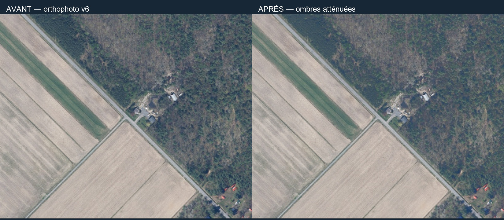

# 08 — Éclaircir les ombres et placer le soleil

**But :** éviter que la photographie et la lumière 3D racontent deux histoires différentes.

Une ombre déjà photographiée ne disparaît pas quand on tourne la lampe de Blender. La v7 atténue donc les tons sombres de l’image, puis règle la direction du soleil.

## A. Refaire la correction enregistrée

1. Ouvre [correction-orthophoto.blend](../plans/animations/eclairage/correction-orthophoto.blend) et fais une copie.
2. Ouvre l’espace **Compositing**. Affiche tous les nœuds avec Home dans l’éditeur.
3. Suis les fils de gauche à droite : image → luminance → masque → multiplication → résultat.
4. Le nœud Image contient la source intacte. Le masque transforme les luminances de **0,008 à 0,085** en un facteur allant de **1 à 0**.
5. Dans le mélange Multiply, la deuxième couleur vaut **1,75** pour R, G et B. C’est le gain maximal des tons sombres sélectionnés.
6. Appuie sur F12, puis sauvegarde l’image avec **Image → Save As**. Compare avec la [comparaison archivée](../plans/animations/eclairage/comparaison-orthophoto.jpg).

**Je vérifie :** les ombres sont moins fortes, sans déplacer les routes. Une terre naturellement sombre peut aussi devenir plus claire. Ce traitement ne recrée pas les détails absents.

## B. Refaire les nœuds dans un document neuf

1. Dans Compositing, active **Use Nodes** et ajoute un nœud **Image**. Ouvre une copie de l’orthophoto.
2. Ajoute **RGB to BW** : relie Image à son entrée.
3. Ajoute **Map Range** : relie la sortie de RGB to BW à Value; saisis 0,008 / 0,085 / 1 / 0 dans les quatre bornes, et active Clamp.
4. Ajoute **Mix**, choisis le mode **Multiply**. Branche l’image d’origine dans la première couleur et le masque dans le facteur.
5. Mets 1,75 dans les composantes de la deuxième couleur, puis relie le résultat à **Composite**.
6. Pour reproduire l’export, utilise une sortie 5000 × 4000, PNG RGB, transformation de vue **Standard**, exposition 0, gamma 1. Il faut aussi une caméra dans la scène pour lancer F12, même si les nœuds utilisent seulement l’image.

Les nombres du masque concernent la lumière **linéaire** traitée par Blender, pas directement les valeurs 0–255 d’un écran. N’applique pas ces seuils au hasard dans un autre logiciel en supposant le même résultat.

## C. Examiner le soleil du film

Dans la scène 03, sélectionne la lumière de type **Sun**. Regarde sa rotation, sa puissance et son angle. La direction enregistrée correspond à un azimut UTM estimé à **140,8°**, avec une incertitude visuelle de ±10°. Sa hauteur de 50° est un choix de rendu.

Un azimut géographique n’est pas directement la rotation Z de l’objet : les rayons d’un Sun suivent son axe local −Z. Pour apprendre, tourne la lumière dans une copie et regarde l’ombre d’un objet simple. Pour conserver notre alignement exact, garde la rotation de la scène ou la conversion du script `appliquer-eclairage.py`.

**Défi :** rends la même image avec deux orientations de soleil. Laquelle correspond mieux aux ombres restantes sur la photographie ? Explique ton choix, sans prétendre retrouver une heure de prise de vue inconnue.

[Notice et limites v7](../plans/animations/eclairage/README.md) · [Suite : caméra](09-camera.md) · [Sommaire](README.md)
