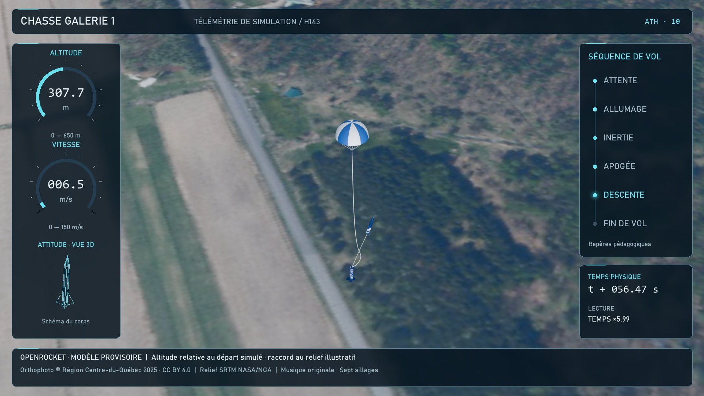

# 11 — Un tableau de bord pour expliquer le vol

**But :** comprendre chaque panneau et apprendre à en refaire une maquette. ATH signifie « affichage tête haute » : les informations sont posées sur l’image.

## Lis le tableau de bord

1. À gauche : altitude et vitesse. Les arcs vont de 0 à 650 m et de 0 à 150 m/s.
2. En dessous : un dessin filaire 3D du corps, orienté comme le corps dans Blender. C’est un schéma, pas une pièce de fabrication.
3. À droite : les étapes du vol. La lueur désigne celle que l’on montre.
4. Plus bas : temps physique et vitesse de lecture.
5. En bas : origine des données, limites et crédits.
6. À l’image 977, le panneau gauche devient un bilan du vol.

Le chronogramme montre des repères pédagogiques. Il ne reproduit pas une nomenclature officielle de l’association. L’apogée est soulignée pendant quelques images autour de l’événement, pour laisser le temps de la voir.

## Fais une maquette à la main

1. Ouvre [apercu-650.jpg](../plans/animations/ath/apercu-650.jpg) et dessine sur papier le contour des panneaux.
2. Choisis une seule jauge à refaire. Dessine un arc et écris sa limite : 650 m.
3. Pour une altitude de 325 m, colorie la moitié de l’arc. Pour 162,5 m, colorie un quart. La règle est `valeur / limite`.
4. Écris la valeur au centre et l’unité dessous. Ne confonds pas une altitude en mètres avec une vitesse en mètres par seconde.
5. Dessine six points pour les phases. Entoure un seul point comme phase courante.
6. Ajoute un petit cartouche « modèle provisoire ».

Pour passer à l’écran sans code, dans un projet Blender Video Editing, ajoute ta vidéo puis une bande **Text** sur un canal supérieur. Saisis par exemple `ALTITUDE : 325 m`, règle sa position et sa taille dans les propriétés de la bande, et limite sa durée à un court passage. Ajoute une bande **Color** sous le texte et au-dessus de la vidéo; règle sa transformation pour en faire un petit panneau. Cette maquette simple n’a pas encore le verre dépoli ni une jauge qui change à chaque image.

## Comment les panneaux exacts sont fabriqués

La v10 ne contient pas un texte Blender indépendant pour chaque nombre. Le script `creer-ath.py` prend chaque image sans titres, découpe la zone derrière le panneau, la floute sur 9 pixels, ajoute un voile sombre et un contour fin, puis dessine les textes et les arcs. Les 1 217 images ainsi composées deviennent le MP4 de la scène 06.

Pour modifier exactement la v10, ouvre le script comme une recette : cherche `glass` pour les panneaux, `gauge` pour les jauges, `wire` pour le schéma 3D, `phase` pour le chronogramme et `draw_report` pour le bilan. Change **un réglage à la fois**, puis lance d’abord le mode `--preview`. Le chapitre 13 explique où placer ses entrées. Modifier un texte dans la scène 03 ne met pas à jour un panneau déjà incrusté dans le MP4.

## Ce que disent les flèches

Pendant deux passages de la montée, cyan = poussée, orange = traînée, bleu = gravité. Leur direction est projetée depuis la scène 3D. Leur longueur **ne permet pas de comparer les forces**. La traînée utilise la vitesse relative au vent moyen, sans reproduire ses fluctuations. Une flèche ne donne donc pas une force en newtons.

## Refais le bilan sur papier

Ouvre [bilan.json](../plans/animations/ath/donnees/bilan.json). Écris cinq lignes : apogée 592,6 m, vitesse maximale 149,2 m/s, durée physique 106,68 s, dérive 163,8 m, vitesse au contact 6,30 m/s. Dessine une courbe altitude/temps physique à partir du CSV, sans utiliser le temps accéléré de la vidéo comme axe horizontal.

**Je vérifie :** mon bilan dit « simulé ». La vitesse au contact est celle avant amortissement visuel. Je n’invente pas une mesure de la vraie fusée.

[Suite : exporter](12-export-publication.md) · [Sommaire](README.md)
